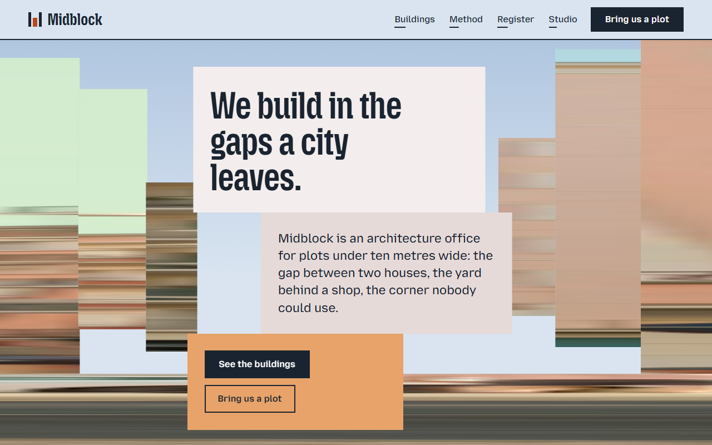

# Free HTML architecture website template with GSAP scroll animations

Architecture website template: a one-page HTML site for a small architecture office, with a projects row that walks sideways, a four-step method, a register table, five team portraits and an enquiry form. The look is flat pastel blocks and street photos that start as smeared colour and sharpen as you scroll. The whole site is one HTML file, and AGENTS.md tells an AI coding agent what to edit and what to leave.

[](LICENSE)  

**[Live demo](https://8bsite.github.io/architecture-website-template/)** · **[Use this template](https://github.com/new?template_name=architecture-website-template&template_owner=8bsite)** · **[Download ZIP](https://github.com/8bsite/architecture-website-template/archive/refs/heads/main.zip)** · **[Template page on 8b.com](https://8b.com/templates/midblock/)**

<a href="https://8bsite.github.io/architecture-website-template/"></a> <a href="https://8bsite.github.io/architecture-website-template/"></a>

<p align="center"><a href="https://8bsite.github.io/architecture-website-template/"></a><br><sub>Scroll animation</sub></p>

## Use it with Claude Code, Cursor or Codex

Download the four files into your project folder (`curl.exe` in Windows PowerShell):

```bash
curl -LO https://raw.githubusercontent.com/8bsite/architecture-website-template/main/index.html
curl -LO https://raw.githubusercontent.com/8bsite/architecture-website-template/main/AGENTS.md
curl -LO https://raw.githubusercontent.com/8bsite/architecture-website-template/main/LICENSE
curl -LO https://raw.githubusercontent.com/8bsite/architecture-website-template/main/CREDITS.md
```

Then fill in the angle brackets and give your agent this prompt:

```text
Read AGENTS.md, then edit index.html. Turn this template into the site for <my architecture office: name, city and studio address, what we design, projects with plot width, floors, year and photos, our working steps, the team with roles, opening hours, how a client sends an enquiry>. Replace first the office name, the city, the five project cards, the register table and the team, and set the footer wordmark's length number to the new name's character count. Keep the section ids, the classes AGENTS.md lists and the form fields named name, email and plot. Ask me for any missing fact and never invent prices, hours, addresses, licences, reviews or contacts.
```

On an architectural website template, collect the facts only the office can give before touching the design: name, city, address, phone, email, hours, each real project with its plot width, floors and year, and the people with their roles. An agent left alone may fill gaps with plausible inventions, so when you vibe code this page with Claude Code, Cursor or Codex, tell it to stop and ask. Each project card takes its width from the inline --plot value, the plot width in metres. Keep the section ids, the classes AGENTS.md lists and the form fields named name, email and plot, which the contact script reads.

No agent? Click **[Use this template](https://github.com/new?template_name=architecture-website-template&template_owner=8bsite)**, edit `index.html` on GitHub and turn on **Settings > Pages**.

## Sections and motion

- **Navigation**: top bar: wordmark, four section links, Bring us a plot button; phone menu overlay.
- **We build in the gaps a city leaves.**: first screen: headline on stepped blocks between slabs of a street photo, then a manifesto and three short facts. Smooth scrolling throughout. The first screen holds while street-photo slabs grow and squeeze from streaks of colour into focus, and the headline blocks drift up.
- **Five buildings, none wider than a bus**: projects walked sideways: five buildings at their relative plot widths, each with a plate. Pinned, the five buildings pass sideways as you scroll; each photo sharpens from a smear and shifts inside its frame.
- **We read a street for a whole day**: method in four steps beside a photo crossed by a red scan line. Scrolling the four steps sends a red line across the photo, leaving a smeared copy behind and lighting each time label.
- **The gap register**: table of entries with status badges (demo: a public list of plots). In view, three colour stripes grow from hairlines and the heading, text and button slide in from alternating sides.
- **Borrowed colours**: six full-width colour bands, each with a name, a sentence and where it is used. Tied to scroll, the six bands unroll downwards one by one, each label wiping in from the left.
- **What the neighbours said**: three testimonials on blocks at stepped heights, with one photo. In view, the three quotes slide in from alternating sides and the photo squeezes from a streak into focus.
- **9 Ropewalk, floor by floor**: one project floor by floor: a building photo cut into seven slices beside a list of seven levels. Reading down the seven levels slides the photo's slices left and right, and the slice for the level being read sits nearest to aligned.
- **Five people, one long table**: team: five portraits at stepped heights with names and roles. Tied to scroll, the five portraits rise or drop into their stepped row, each sharpening from a streak.
- **Questions we hear on site**: questions and answers (native &lt;details&gt;). The heading and its intro slide in from opposite sides as the section comes into view.
- **Bring us a plot**: enquiry form between two street-photo slabs, then address, phone, email and hours. Tied to scroll, two street-photo slabs slide in from the edges towards the form and sharpen from streaks.
- **Footer**: colour bands, width-filling MIDBLOCK wordmark, links, address, copyright and the Design: 8B credit. As the footer comes into view, four colour stripes grow from hairlines above the full-width wordmark.

## Design

 page background, pale sky  
 text, buttons, dark sections  
 cream blocks: the headline block, two of the three facts, the first quote, the form panel  
 brick red stripes, hovers  
 sand: third block on the first screen, labels on navy, one colour band  
 door green: badge markers and one colour band  
 tram blue band  
 red scan line and thin red bands  
 register and team sections, text on navy  
 muted grey-blue for small labels, table headings, notes and rules on navy  
 upper end of the sky gradient behind the first screen  
 plaster pink blocks and one colour band

**Mozilla Headline**: section headings and the wordmark: condensed, semi-bold, tight lines. **Mozilla Text**: body text, buttons, form fields and spaced uppercase labels (Google Fonts). Square-cornered blocks of flat colour stand on a pale sky, stepped like facades along a street. Photos are cut into vertical slabs or sized by each plot's relative width above a striped pavement. Colour bands, 2px rules and portraits at stepped heights carry the street idea down the page.

## Questions

**Does the enquiry form send anything?**  
No. As shipped, the form checks that a name, a valid email and the plot address are present, shows a thank-you line and clears the fields; no request is made anywhere. To receive enquiries, wire it to Formspree or, on Netlify, to Netlify Forms; AGENTS.md gives the code for both. The thank-you text also promises a reply within a week, so change that to your own promise.

**Can the register table list finished projects instead?**  
Yes. It is a plain HTML table with five columns and a status badge, and no script touches it, so rows can be added, removed or turned into projects, sites or listings. On phones each row folds into a stacked record with labels for width, depth and orientation.

**Are there architecture portfolio website examples I can look at?**  
The live demo is one. It shows an invented small office with five projects, an eight-row register and a five-person team in a single HTML file. Every name, address and figure in it is made up, so replace them and swap the photos before publishing.

## Is it the right base?

Among website templates for architects, this one suits a practice with about five projects worth showing and a method to explain. A builder who quotes jobs after a site visit is better served by the [contractor](https://8b.com/templates/ashlar/) template, which is built around services, prices and visits. A firm with a long archive of projects needs a site with more than one page. What this layout cannot do as shipped is give each building its own page: the project cards are plain blocks, not links. With motion on, the sideways row also pins the page for a stretch of scrolling before the method section.

## Before you publish

- Replace what is marked `data-8b-placeholder` (social preview image, favicon, form, phone, email) and the invented demo facts; [AGENTS.md](AGENTS.md) lists them.
- The form sends nothing yet: connect it to Formspree or Netlify Forms, or remove it.

## Tech

GSAP 3.13.0, ScrollTrigger, Lenis 1.3.27 from jsDelivr, 93 KB, no build step. Chrome and Edge 108+, Safari 15.4+, Firefox 101+ (it uses cascade layers, small/dynamic viewport units). With "reduce motion" on, the page is complete and still.

## License

MIT, see [LICENSE](LICENSE). Photos, fonts and libraries keep their own licences: [CREDITS.md](CREDITS.md). More free templates: [8b.com/templates](https://8b.com/templates/) · [github.com/8bsite](https://github.com/8bsite).
