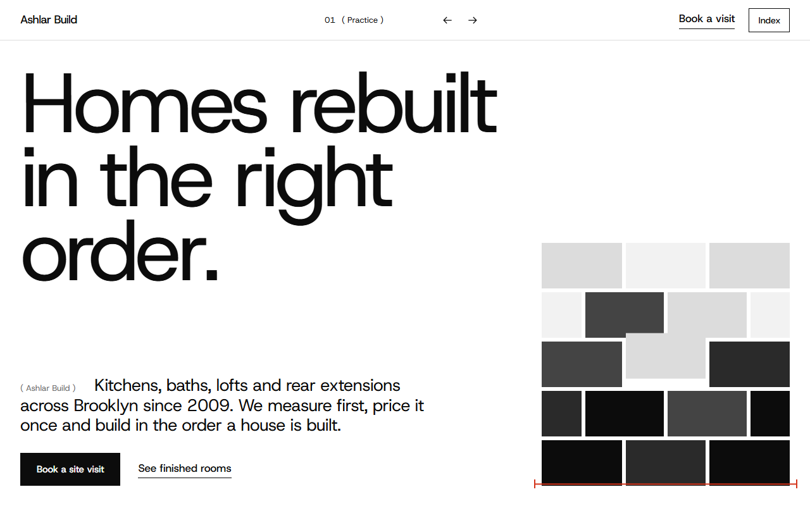
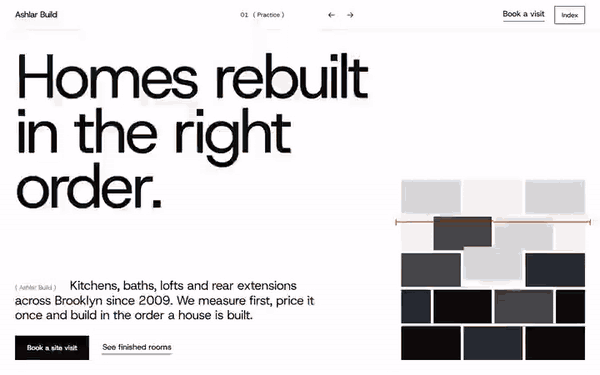

# Free HTML construction company website template with GSAP scroll animations

Construction company website template: one free HTML page for a home renovation and extension contractor, with five services that carry timings and prices, a measured-survey section, twelve finished rooms, a crew, reviews and a site-visit form. The look is black, white and grey with red measuring marks. It is a single file with an AGENTS.md, so Claude Code, Cursor or Codex can adapt it to your firm.

[](LICENSE)  

**[Live demo](https://8bsite.github.io/construction-company-website-template/)** · **[Use this template](https://github.com/new?template_name=construction-company-website-template&template_owner=8bsite)** · **[Download ZIP](https://github.com/8bsite/construction-company-website-template/archive/refs/heads/main.zip)** · **[Template page on 8b.com](https://8b.com/templates/ashlar/)**

<a href="https://8bsite.github.io/construction-company-website-template/"></a> <a href="https://8bsite.github.io/construction-company-website-template/"></a>

<p align="center"><a href="https://8bsite.github.io/construction-company-website-template/"></a><br><sub>Scroll animation</sub></p>

## Use it with Claude Code, Cursor or Codex

Download the four files into your project folder (`curl.exe` in Windows PowerShell):

```bash
curl -LO https://raw.githubusercontent.com/8bsite/construction-company-website-template/main/index.html
curl -LO https://raw.githubusercontent.com/8bsite/construction-company-website-template/main/AGENTS.md
curl -LO https://raw.githubusercontent.com/8bsite/construction-company-website-template/main/LICENSE
curl -LO https://raw.githubusercontent.com/8bsite/construction-company-website-template/main/CREDITS.md
```

Then fill in the angle brackets and give your agent this prompt:

```text
Read AGENTS.md, then edit index.html. Turn it into the site for <my building firm: kinds of job, service area, weeks and starting price per job, survey fee, payment stages, guarantee terms, licence and insurance line, office address and hours, crew names and trades, real reviews and project photos>. Replace first the company name, the five services and the twelve project photos. Keep the section ids, the classes AGENTS.md lists, the chapter labels matching in the Index and the footer link, the five order-of-work stages and the --len number on Fixed. Ask me for any missing fact and never invent prices, licence numbers, addresses, reviews or contacts.
```

In a vibe coding session with Claude Code, Cursor or Codex, tell the agent to start with what only the owner knows: trades, service area, the weeks and starting price of each job, the survey fee, payment terms, licence and insurance line, office address, hours and the real crew. All of it is invented in the demo, so the agent must ask. Keep the ids, the classes AGENTS.md lists and the chapter labels, which are written in each section intro, the Index list and the footer link. The services frame pairs each row with the photo in the same position.

No agent? Click **[Use this template](https://github.com/new?template_name=construction-company-website-template&template_owner=8bsite)**, edit `index.html` on GitHub and turn on **Settings > Pages**.

## Sections and motion

- **Navigation**: top bar: wordmark, current chapter with previous/next arrows, Book a visit, Index overlay.
- **Homes rebuilt in the right order.**: first screen: headline, lead, two buttons and a wall of grey blocks; second screen: room photo with a statement panel and three facts. Smooth scrolling throughout; headings rise into place. On scroll the grey wall breaks apart block by block and the white page opens from the wall's outline onto a room photo.
- **Five kinds of job, one way of working**: list of services with duration and starting price beside a sticky photo frame (demo: kitchens, bathrooms, lofts, extensions, restoration). As each service reaches the middle, its photo wipes up over the last in the sticky frame and other rows dim; on wide screens the frame's crop changes too.
- **A fixed price, from a measured survey.**: how quoting works: a measured photo with red dimension lines and four numbered notes. As the survey photo scrolls into view it opens out from a rounded inset, and red width and height lines draw above and to the right of it.
- **Rooms we handed back**: black gallery: twelve project photos with room and neighbourhood captions. On wide screens the gallery pins while twelve scattered, tilted photos settle into a contact sheet of square photos as you scroll.
- **Five materials we keep coming back to**: five material strips with a photo, name and use (demo: plaster, oak, marble, slate, steel). On wide screens five material strips start folded into narrow bands in shades of grey at the right edge and fan out across the row as you scroll.
- **Built in the order a house is built**: five work stages laid as blocks of a wall, each with a week range. On wide screens the section pins and the stage blocks fly in from alternate sides, building the wall from the bottom up.
- **Fixed**: guarantees: one huge condensed word and three written promises. The word Fixed squeezes from wide to condensed as you scroll, with four copies sliding down into it.
- **The people who quote are the people on site**: team row: five portraits at varied heights with name and trade, Shuffle button. Portraits open out from rounded insets as they scroll into view; the Shuffle button reorders the crew on click.
- **What people say after handover**: four client quotes on grey-to-black cards that stack as you scroll. Review cards stick and stack as you scroll, each shrinking and fading as the next slides over it.
- **Before you call**: questions and answers (native &lt;details&gt;).
- **Book a site visit**: site-visit request: address, phone, email, hours, a photo and a form (placeholders). Tied to scroll, the two heading lines slide in from opposite sides and the grey form sheet unfolds downward.
- **Footer**: black footer: big back-to-top link, address, contacts, section links, licence line, copyright and the Design: 8B credit.

## Design

 white page background  
 black text, buttons, gallery and footer  
 light grey panels and form sheet  
 pale grey hairlines and blocks  
 dark grey blocks and button hover  
 charcoal cards and blocks  
 red measuring marks, link hover lines and focus outlines  
 grey small labels

**Host Grotesk**: headings, body and labels: regular weight even at large sizes, very tight letter spacing on the big headings. **TikTok Sans**: the huge word Fixed: condensed and sized to fill the page width (Google Fonts). A 12-column grid with hairline rules and mostly square corners. Small labels in brackets number every chapter, and the navigation bar shows the current one. Red dimension lines measure the survey photo and the form, grey blocks build a wall on the first screen, and the work stages are laid as wall courses.

## Questions

**Does the site-visit form send requests?**  
No. The form takes a name, phone, email, house address, kind of job and a note, needs a name plus an email or a phone number, then shows a thank-you line and clears itself. Nothing leaves the page until you connect Formspree or Netlify Forms, or remove the form and keep the email link. Also edit the promise to call within one working day.

**What should the websites of construction companies show besides photos?**  
Prices or ranges, timings, how a quote is reached, who does the work, proof from past clients and an easy way to ask for a visit. This template covers each: services carry a timing and a price line, the survey explains the quote, crew and reviews give the proof, and the form asks for a visit.

**Which facts in the demo are made up?**  
All of them. The Brooklyn address, phone, email, licence and insurance line, prices, weeks, survey fee, guarantees, crew names and years and the four reviews are invented. Placeholders carry data-8b-placeholder, and AGENTS.md lists the invented facts with the section each sits in, so an agent can ask for the real ones.

## Is it the right base?

Choose this construction company template for a firm that renovates and extends homes and prices each job after measuring the house: a general contractor, a kitchen and bathroom specialist, a loft converter or a design-and-build practice. A roofer or a commercial builder would rewrite most of the five services, the survey and the promises. An office that mostly draws buildings and hands the work to others fits the [architecture](https://8b.com/templates/midblock/) template better. The weak spot is scroll length: on wide screens the gallery and the order-of-work section each pin the page for more than a screen of scrolling, and the second shows only its heading and intro at first.

## Before you publish

- Replace what is marked `data-8b-placeholder` (social preview image, favicon, phone, email, form, social) and the invented demo facts; [AGENTS.md](AGENTS.md) lists them.
- The form sends nothing yet: connect it to Formspree or Netlify Forms, or remove it.

## Tech

GSAP 3.13.0, ScrollTrigger, Lenis 1.3.27 from jsDelivr, 107 KB, no build step. Chrome and Edge 108+, Safari 15.4+, Firefox 101+ (it uses cascade layers, small/dynamic viewport units). With "reduce motion" on, the page is complete and still.

## License

MIT, see [LICENSE](LICENSE). Photos, fonts and libraries keep their own licences: [CREDITS.md](CREDITS.md). More free templates: [8b.com/templates](https://8b.com/templates/) · [github.com/8bsite](https://github.com/8bsite).
