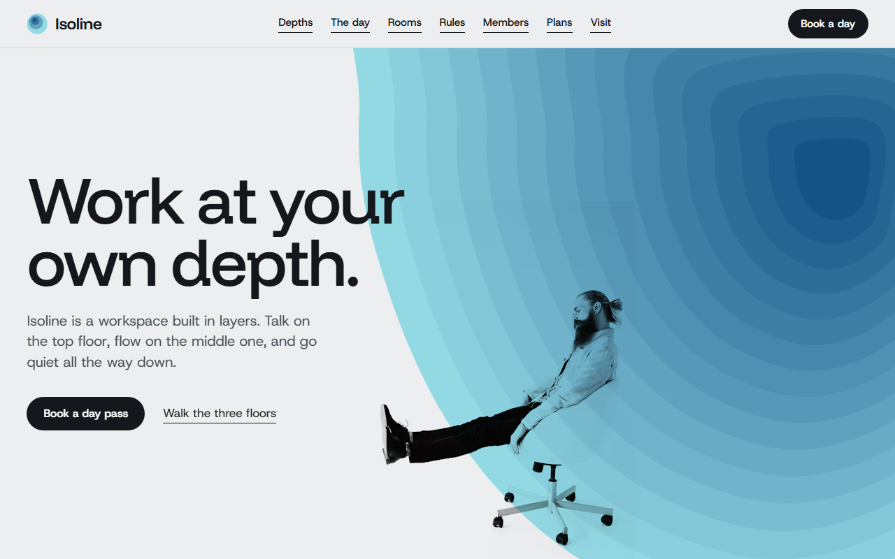

# Free HTML coworking website template with GSAP scroll animations

Coworking website template: a one-page site for a coworking space whose floors differ by noise, with a weekday schedule, house rules, member profiles, three priced plans and a tour request form. Nested colour bands, like contour lines, mark each level in orange, blue and violet. It is one HTML file with an AGENTS.md, so Claude Code, Cursor or Codex can adapt it to your own space.

[](LICENSE)  

**[Live demo](https://8bsite.github.io/coworking-website-template/)** · **[Use this template](https://github.com/new?template_name=coworking-website-template&template_owner=8bsite)** · **[Download ZIP](https://github.com/8bsite/coworking-website-template/archive/refs/heads/main.zip)** · **[Template page on 8b.com](https://8b.com/templates/isoline/)**

<a href="https://8bsite.github.io/coworking-website-template/"></a> <a href="https://8bsite.github.io/coworking-website-template/"></a>

<p align="center"><a href="https://8bsite.github.io/coworking-website-template/"></a><br><sub>Scroll animation</sub></p>

## Use it with Claude Code, Cursor or Codex

Download the four files into your project folder (`curl.exe` in Windows PowerShell):

```bash
curl -LO https://raw.githubusercontent.com/8bsite/coworking-website-template/main/index.html
curl -LO https://raw.githubusercontent.com/8bsite/coworking-website-template/main/AGENTS.md
curl -LO https://raw.githubusercontent.com/8bsite/coworking-website-template/main/LICENSE
curl -LO https://raw.githubusercontent.com/8bsite/coworking-website-template/main/CREDITS.md
```

Then fill in the angle brackets and give your agent this prompt:

```text
Read AGENTS.md, then edit index.html. Turn it into the site for <my workspace: name, city and address, the levels or zones with the sound rule of each, opening hours, day pass and membership prices with currency and what each includes, weekly events, how people book or ask for a tour>. Replace first the brand name in any letter case, the level names, the four rooms and the plan prices. Keep the section ids, the data-8b-section and data-8b-motion attributes, the classes AGENTS.md lists and the footer wordmark's --len set to its character count. Ask me for any missing fact and never invent prices, hours, addresses, member quotes, events or contacts.
```

Hand the file to Claude Code, Cursor or Codex and let the vibe coding start with questions: the agent needs the address, phone and hours, what each plan costs and in which currency, and how many seats, carrels or booths exist. It must invent none of it. The demo shows euro prices beside a Leeds address, so settle on one currency. Rename the brand in any letter case, set the footer wordmark's --len to the new name's length and rewrite the three level rules. Keep the ids, the data-8b-section and data-8b-motion attributes and the classes AGENTS.md lists. A redrawn colour field keeps m-well__band on each band group, with --well-d from 0 at the rim to 1 at the core.

No agent? Click **[Use this template](https://github.com/new?template_name=coworking-website-template&template_owner=8bsite)**, edit `index.html` on GitHub and turn on **Settings > Pages**.

## Sections and motion

- **Navigation**: top bar: wordmark, section links, Book a day button; phone menu overlay.
- **Work at your own depth.**: two screens: headline over a huge colour field with a figure on its edge, then a statement and three anchors on the field's colour. Smooth scrolling runs page-wide. The bands breathe on a loop; on scroll they swell until deep blue fills the screen, the figure shrinking into the field.
- **Three depths. Pick one each morning.**: three hanging posters, one per zone or level, each with its own colour field, photo and caption (demo: the three floors). Section headings rise line by line throughout. Tied to scroll, the three posters lower on their wires and swing as their bands appear.
- **The building has a day of its own.**: daily schedule beside a sticky colour dial (demo: a weekday from 7:30 to 21:00). As you read the schedule, the sticky dial's bands shift by depth and turn orange, blue, violet, then orange; other rows dim.
- **Rooms, in order of descent.**: list of rooms indented by level, each with a small hanging photo. Each small print swings on its clips and settles with an elastic bounce as it scrolls into view.
- **Three rules, posted at the stairs.**: three short house rules inside a V-shaped cross-section of bands. Tied to scroll, nine coloured bands start joined in the middle and slide apart to the edges, upper rows first, leaving a V-shaped gap around the rules.
- **Who works down here.**: four members with photo, name, job and a quote, each under a small colour field. Each member's small colour field ripples open from its core outward as the portrait scrolls into view.
- **Surfacing, on Thursday evenings.**: list of upcoming events with date, time, title, speaker, place and a Save a seat link (demo: Thursday talks). Each event row shifts from plum to blue to aqua as it crosses the screen, its date drifting up against it.
- **Finished at depth.**: table of works members finished, each with a small stepped colour swatch. The three-bar swatch in each row of finished works steps up bar by bar as it scrolls into view.
- **How deep a membership goes.**: three pricing plans as colour fields whose band count shows how much each includes. Each plan's field fills in band by band as you scroll; the deeper plans gather more bands.
- **Come down for a day.**: contact: address, hours, phone, email, a drawn contour map and a tour request form (placeholders). The contour lines of the drawn map ripple in one after another as the map scrolls into view.
- **Footer**: tagline with address, links, wordmark, copyright and the Design: 8B credit, hours line.

## Design

 page background  
 text, buttons, print clips, footer  
 secondary text  
 members and plans grounds, prints, badges  
 grey gradient ground behind the three hanging posters  
 aqua rim of blue fields, hover rings  
 deep blue Flow fields, second hero screen, event rows  
 pale yellow rim of orange fields  
 orange core of Shallow fields  
 lilac rim of Deep fields  
 plum core of Deep fields, fading to lilac

**Funnel Display**: headings, times, prices: large, medium weight, tight. **Host Grotesk**: body, labels, buttons, badges (Google Fonts). Colour fields of nested stepped bands, pale at the rim and dark at the core, carry the page, with cut-out figures on their edges. Photos hang as prints from two black clips on thin wires, and rooms step further right as they go down.

## Questions

**Does the tour request form send anything?**  
No. As shipped, it checks that the name is filled and the email looks like an address, shows a thank-you line, clears the fields and sends nothing. Wire it to Formspree or, on Netlify, to Netlify Forms; with no form service, remove the form and its script and keep the email link. The thank-you line promises a reply within a day, so match it to your real response time.

**Can this coworking website template take payments or bookings?**  
No. There is no checkout, availability calendar or member login. The Book a day button in the bar and the Book a day pass button on the first screen link to the plans section, while the three plan buttons and the Save a seat links go to the visit section. Point each at your booking tool or checkout address.

**Will it suit a quiet study space or a writers' room on a single floor?**  
Yes, with edits. The three levels are plain text and three colour pairs, so they can become zones in one room, such as a hot desk area, a quiet corner and booths. The day schedule can have more or fewer rows than the demo's seven. The grid is built for three posters, three plans and four rooms, so rewrite those in place.

## Is it the right base?

It is the right base when what you sell is how each part of the building sounds, for example a roof for calls, a long room for low voices and sealed booths for silence. If your members come for the programme and the people more than for the desks, the [members' club](https://8b.com/templates/softlife/) template is a closer base, and one open room with a single price list needs less than this page carries. Where it is thin is booking: as a coworking space website template it offers a tour request form and buttons you point elsewhere, with no availability calendar, checkout or member login.

## Before you publish

- Replace what is marked `data-8b-placeholder` (social preview image, favicon, phone, email, form) and the invented demo facts; [AGENTS.md](AGENTS.md) lists them.
- The form sends nothing yet: connect it to Formspree or Netlify Forms, or remove it.

## Tech

GSAP 3.13.0, ScrollTrigger, SplitText, Lenis 1.3.27 from jsDelivr, 153 KB, no build step. Chrome and Edge 111+, Safari 16.2+, Firefox 113+ (it uses color-mix(), cascade layers). With "reduce motion" on, the page is complete and still.

## License

MIT, see [LICENSE](LICENSE). Photos, fonts and libraries keep their own licences: [CREDITS.md](CREDITS.md). More free templates: [8b.com/templates](https://8b.com/templates/) · [github.com/8bsite](https://github.com/8bsite).
