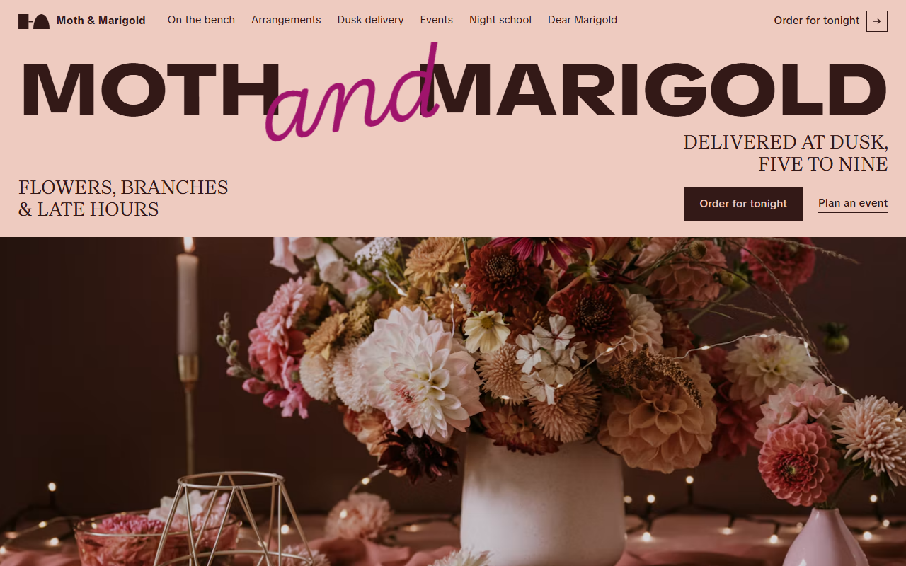
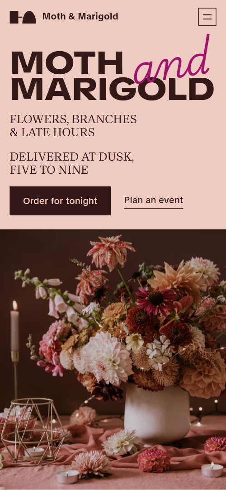
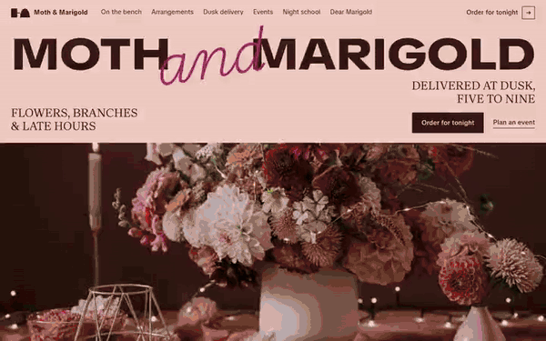

# Free HTML florist website template with GSAP scroll animations

Florist website template: a one-page site for a flower shop that delivers in the evening, with this week's stems, a delivery track, weekly standing orders, wedding and event pricing, workshops and an order form. Blush and chocolate grounds carry handwriting in hot pink and magenta. It is one HTML file with an AGENTS.md, so Claude Code, Cursor or Codex can adapt it to your shop.

[](LICENSE)  

**[Live demo](https://8bsite.github.io/florist-website-template/)** · **[Use this template](https://github.com/new?template_name=florist-website-template&template_owner=8bsite)** · **[Download ZIP](https://github.com/8bsite/florist-website-template/archive/refs/heads/main.zip)** · **[Template page on 8b.com](https://8b.com/templates/moth-marigold/)**

<a href="https://8bsite.github.io/florist-website-template/"></a> <a href="https://8bsite.github.io/florist-website-template/"></a>

<p align="center"><a href="https://8bsite.github.io/florist-website-template/"></a><br><sub>Scroll animation</sub></p>

## Use it with Claude Code, Cursor or Codex

Download the four files into your project folder (`curl.exe` in Windows PowerShell):

```bash
curl -LO https://raw.githubusercontent.com/8bsite/florist-website-template/main/index.html
curl -LO https://raw.githubusercontent.com/8bsite/florist-website-template/main/AGENTS.md
curl -LO https://raw.githubusercontent.com/8bsite/florist-website-template/main/LICENSE
curl -LO https://raw.githubusercontent.com/8bsite/florist-website-template/main/CREDITS.md
```

Then fill in the angle brackets and give your agent this prompt:

```text
Read AGENTS.md, then edit index.html. Turn this template into the site for <my flower shop: name, street and town, opening hours, delivery window and order cut-off, delivery area and fee, this week's stems, growers and prices, standing order plans, event pricing, workshop dates, contacts>. Replace first the shop name, address, delivery rules, stems and standing orders. Keep the section ids, the classes AGENTS.md lists and each stem row in the same position as its photo. Reset --len to a reworded line's character count and set each grower's --mi to its distance in miles. Ask me for missing facts and never invent prices, hours, addresses, grower names, reviews or contacts.
```

To make this flower shop website template your own in a vibe coding session, point Claude Code, Cursor or Codex at AGENTS.md and let it begin with the shop's facts. Those are the name, street, opening hours, delivery window and order cut-off, the stems on the bench, the standing orders and the workshop dates. The demo invents every one, growers and distances included, so the agent should ask you rather than guess. Leave the section ids and the classes AGENTS.md lists for each script. Reset --len on a reworded big line to its character count, and set --mi on each grower row to that grower's distance in miles. Stems pair with their photos by position, so edit them together.

No agent? Click **[Use this template](https://github.com/new?template_name=florist-website-template&template_owner=8bsite)**, edit `index.html` on GitHub and turn on **Settings > Pages**.

## Sections and motion

- **Navigation**: top bar: brand mark and name, section links, Order for tonight button; phone menu overlay with address, hours and phone.
- **Moth and Marigold**: first screen: width-filling brand wordmark, two taglines, two actions and a shop photo; then a dark statement screen (demo: "after five"). Smooth scrolling throughout; most section headings lift in. On scroll the chocolate night rises over the first screen as a widening dome while the shop photo darkens and the wordmark spreads.
- **What the fields sent**: this week's stock: six items with source, distance and price, beside one held photo frame (demo: flower stems). In the sticky frame the front stem photo slides away left as each row passes, revealing the next, and that next stem's name turns bold magenta.
- **Flowers that moved in**: portfolio grid of six arrangements, each with a title and a place/month caption. The columns of arrangements, three on desktop and two on phones, start at different heights and settle into line as you scroll; the script ribbon slides sideways.
- **Cut at five, at your door by nine**: how delivery works: five hour panels (5 pm to 9 pm) on a horizontal track, each a shade darker. The section pins and five hour panels slide sideways from 5 pm to 9 pm, each darker, their photos moving at their own speed.
- **The same evening, every week**: price list of three weekly subscriptions as table rows (demo: The Jar, The Mantel, The Lobby).
- **Big flowers for long tables**: event services with prices and lead times, a button, and a board of six event photos. Tied to scroll, the six event photos start in a loose, tilted pile near the upper centre of the board and spread out into place.
- **Grown within two hundred miles**: suppliers placed on a 0 to 200 mile scale by distance (demo: seven flower growers). As you scroll, each grower's pin slides from zero along the mile scale to its distance, drawing a line behind it.
- **Two hours at the bench after closing**: workshops: four dated classes with price and seats left, a booking button and one photo (demo: Thursday night school). As the workshop photo scrolls into view it opens like a window from a narrow centre strip.
- **Dear Marigold**: journal or blog: one featured post beside a tall photo, two shorter posts (demo: "Dear Marigold" care column). While you read the featured letter, the tall photo in its sticky frame slides slowly up to show its lower part, tied to scroll.
- **Before you order**: questions and answers (native &lt;details&gt;).
- **Tell us who they're for**: order form on a card over a shop photo, with address, hours, phone and email. Tied to scroll, the order card slides in from the right with a slight tilt over the shop photo, which zooms out.
- **Footer**: large brand mark built from three blocks, link columns, address and contacts, copyright and the Design: 8B credit. The big brand mark assembles as you reach it: block from the left, dome from below, then the bar between.

## Design

 blush page background and cards  
 chocolate text and dark sections  
 hot pink script lines and button hover  
 magenta workshop band, distance pins and second script colour

**TikTok Sans**: wordmark: black weight, extra wide, uppercase; also body text and labels. **Brygada 1918**: section headings, stem names and standing order prices: uppercase serif. **Playwrite US Trad**: thin handwritten script in hot pink and magenta, set as large as headlines (Google Fonts). Blush and chocolate bands mostly alternate, with a magenta band for the workshops; corners are square apart from the pill-shaped distance pins and the dome in the footer mark, and rules are hairlines. The wordmark fills the width with a tilted script 'and', and script lines as big as headlines ('after five', 'rooms in bloom') sit inside their sections. Photos hold in sticky frames beside lists, and growers sit on a 0 to 200 mile scale.

## Questions

**Does the order form take orders?**  
No. The form asks for a name, a phone or email, the evening, a budget and a note, checks that name and contact are filled in, then shows a thank-you line and sends nothing. Connect Formspree or Netlify Forms, or delete the form with its script and keep the email link. Reword the thank-you line, which promises a call before five.

**Can it work for florist ecommerce websites that take payments?**  
Not on its own. The file has no cart, checkout or payment code, and the order form sends nothing until you connect a service. Point the Order for tonight, Build a bouquet and standing order buttons at your online shop or order page, and let this page carry the stems, the delivery hours, the events and the story.

**How do I update the weekly stems and prices?**  
Edit the rows under the bench heading: each has a name, a source, a distance, a price and a note. Every row pairs with one photo in the sticky frame by position, so change the photos in the same order, and add or remove a row together with its photo.

## Is it the right base?

This is the right base when the shop's week has a rhythm: stock that changes, a delivery window, regulars on standing orders, and dated classes and events booked ahead. Another small shop that sells on a schedule, like a [print studio](https://8b.com/templates/dotdrum/) with dated workshops and a price calculator, fits a different template, and so does any business built around a product catalog. As a wedding florist website template it works if you keep the events and arrangements sections and trim the rest. The weak spot is commerce: stems, plans and classes are text, and nothing on the page takes a payment.

## Before you publish

- Replace what is marked `data-8b-placeholder` (social preview image, favicon, phone, social, email, form) and the invented demo facts; [AGENTS.md](AGENTS.md) lists them.
- The form sends nothing yet: connect it to Formspree or Netlify Forms, or remove it.

## Tech

GSAP 3.13.0, ScrollTrigger, Lenis 1.3.4 from jsDelivr, 100 KB, no build step. Chrome and Edge 111+, Safari 16.2+, Firefox 113+ (it uses color-mix(), container query units, cascade layers, small/dynamic viewport units). With "reduce motion" on, the page is complete and still.

## License

MIT, see [LICENSE](LICENSE). Photos, fonts and libraries keep their own licences: [CREDITS.md](CREDITS.md). More free templates: [8b.com/templates](https://8b.com/templates/) · [github.com/8bsite](https://github.com/8bsite).
