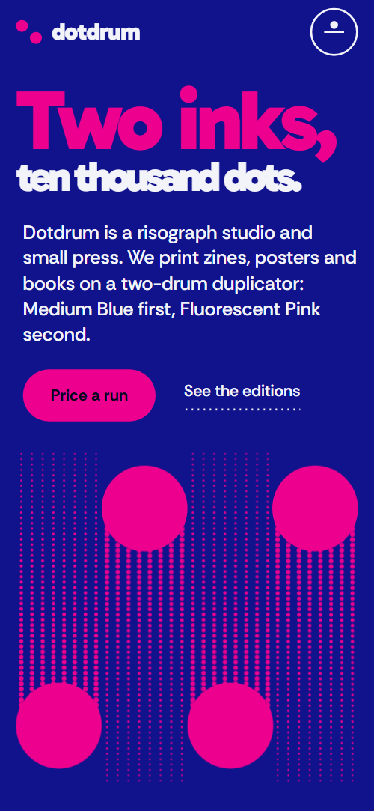
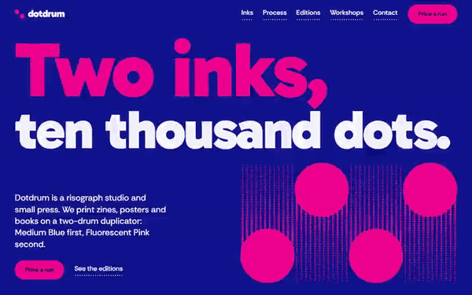

# Free HTML print studio website template with GSAP scroll animations

Print studio website template: a free one-page site for a risograph studio, print shop or small press, with a live price calculator, a shelf of eight editions, five dated workshops and a contact form. The look is two flat inks, ultramarine and fluorescent pink, with halftone dots drawn in CSS. It is one HTML file with an AGENTS.md, so an AI agent such as Claude Code can adapt it to your own studio.

[](LICENSE)  

**[Live demo](https://8bsite.github.io/print-studio-website-template/)** · **[Use this template](https://github.com/new?template_name=print-studio-website-template&template_owner=8bsite)** · **[Download ZIP](https://github.com/8bsite/print-studio-website-template/archive/refs/heads/main.zip)** · **[Template page on 8b.com](https://8b.com/templates/dotdrum/)**

<a href="https://8bsite.github.io/print-studio-website-template/"></a> <a href="https://8bsite.github.io/print-studio-website-template/"></a>

<p align="center"><a href="https://8bsite.github.io/print-studio-website-template/"></a><br><sub>Scroll animation</sub></p>

## Use it with Claude Code, Cursor or Codex

Download the four files into your project folder (`curl.exe` in Windows PowerShell):

```bash
curl -LO https://raw.githubusercontent.com/8bsite/print-studio-website-template/main/index.html
curl -LO https://raw.githubusercontent.com/8bsite/print-studio-website-template/main/AGENTS.md
curl -LO https://raw.githubusercontent.com/8bsite/print-studio-website-template/main/LICENSE
curl -LO https://raw.githubusercontent.com/8bsite/print-studio-website-template/main/CREDITS.md
```

Then fill in the angle brackets and give your agent this prompt:

```text
Read AGENTS.md, then edit index.html. Make it the site for <my print studio: inks, formats, papers, town and address, opening hours, rates per copy, setup fee, turnaround by run size, editions with prices, workshops with dates and prices, past clients, how people order and book>. Replace first the studio name, ink names, colours, calculator rates, editions and workshops. Set each display line's length number to its new character count. Keep the opening's drum lanes and pink bands equal in number, the calculator's data attributes, and the section ids and classes AGENTS.md lists. Ask me for any missing fact and never invent prices, dates, hours, addresses, clients, reviews or contacts.
```

In a vibe coding session with Claude Code, Cursor or Codex, ask the agent to collect your rate per copy by format, the setup fee, the paper stocks, the largest sheet, turnaround by run size and opening hours. Rates, setup fee and turnaround go into the quote form's data attributes, the rest into the text. Next it searches for the old name in any letter case and resets the length number on the headline lines and the footer wordmark. Keep the opening's drum lanes and pink bands equal, four in the layout: when they differ, the print script throws, its scroll animation stays off and the console logs an error. The agent must never invent clients, prices or dates.

No agent? Click **[Use this template](https://github.com/new?template_name=print-studio-website-template&template_owner=8bsite)**, edit `index.html` on GitHub and turn on **Settings > Pages**.

## Sections and motion

- **Navigation**: top bar: wordmark, section links, Price a run button; phone menu overlay.
- **Two inks, ten thousand dots.**: two-screen opening: big two-line headline and four drums with halftone trails, then a pink panel with the studio statement, a photo and three facts. Smooth scrolling throughout. Scrolling down, four pink drums roll onto the panel below and print it band by band; the photo appears through growing halftone dots.
- **Two inks. Sixteen colours.**: colour chart: two ink plates overprint into a 4×4 grid of tints (demo: blue and pink). The heading starts with an offset ghost that slides into register. Tied to scroll, the tilted blue and pink plates slide together into the chart.
- **One sheet, two passes.**: how it works: five numbered steps on a horizontal track beside a sheet that gets printed step by step. Pinned, the five stations slide sideways while the sheet beside them takes a blue pass, then a pink pass that nudges into register.
- **A small room with a loud machine.**: about the studio: paragraph, list of four machines, three photos at alternating heights.
- **From our own drum.**: shop: eight products in four staggered lanes, each with photo, title, format, price and Order link (demo: zines, prints and books). Tied to scroll, alternate product lanes slide up and down like pistons into their staggered places, printing dotted trails.
- **Learn the drum.**: event list: five dated sessions with price, places left and a Book link, beside a lane where a drum inks each date. A pink drum rolls down beside the list as you scroll, and each date fills solid pink as the drum passes.
- **Price a run.**: price calculator: job options on the left, a live job ticket with total, unit price and turnaround, and a Send this ticket email button.
- **Lately on the drum.**: list of recent clients and jobs set in large type (demo: a press log). Client names drift left or right away from mid-screen, with a pink ghost that closes up as each reaches the centre.
- **Before you send a file.**: questions and answers (native &lt;details&gt;).
- **Bring a file. Leave with a stack.**: address, opening hours, email, phone and a contact form (placeholders), four drums across the foot. Tied to scroll, four drums drop down their lanes at staggered times, printing dotted trails behind them.
- **Footer**: width-filling dotdrum wordmark, links, address, socials, copyright and the Design: 8B credit.

## Design

 ultramarine: the blue bands and the text on paper white  
 fluorescent pink: drums, halftone trails, buttons, the studio and questions bands  
 paper white bands, and the text on blue  
 near-black: text on pink, button labels, secondary text on paper white

**Gabarito**: heavy, tight headings; the two headline lines and the footer wordmark are sized from their character count to fill the width. **Rethink Sans**: body text, buttons, uppercase labels (Google Fonts). Full-width bands of ultramarine, paper white and fluorescent pink. The graphics are drawn in the two inks: CSS halftone dots and registration marks, round drums trailing dotted lines, blue-and-pink duotone photos. The ink chart overprints two plates into a 4×4 grid; the job ticket has a perforated upper edge.

## Questions

**How do I set my own prices in this print shop template?**  
Edit the data attributes. Each format carries data-rate, the inks, paper and sides carry data-factor, the form carries data-setup (charged per ink), and data-days-small, data-days-mid and data-days-large set the working days. The currency and the 500 and 1,500 copy limits sit in the quote script.

**Can this work as an online print shop website template with file upload and checkout?**  
No, not as shipped. The contact form asks for a name, an email and what you are printing, and nothing on the page takes a file, holds a cart or charges a card. Order and Book a place links open an email. Point them at your own shop or ticketing page when you need online payment.

**Can this work as a website template for printing company sites that use offset or digital presses?**  
Partly. Rates, setup fee and turnaround are plain data, so the prices adapt. The calculator assumes one or two inks, the process stations describe a duplicator and the studio section lists a guillotine, a stapler and a drying rack, so an offset or digital printer should rewrite those parts and keep the rest.

## Is it the right base?

Choose this base when the studio sells by the run and by the edition, and the pitch is a look made from two inks. As a print company website template it suits a small shop, not a plant with sales reps and a long product catalogue. A shop whose stock changes every week and goes out in delivery windows, like a [flower shop](https://8b.com/templates/moth-marigold/) with standing orders, needs a different template. The weak spot is checkout: the calculator prices a job and Send this ticket opens an email, with no file upload, cart or card payment.

## Before you publish

- Replace what is marked `data-8b-placeholder` (social preview image, favicon, email, form, phone, social) and the invented demo facts; [AGENTS.md](AGENTS.md) lists them.
- The form sends nothing yet: connect it to Formspree or Netlify Forms, or remove it.

## Tech

GSAP 3.13.0, ScrollTrigger, Lenis 1.3.27 from jsDelivr, 99 KB, no build step. Chrome and Edge 111+, Safari 16.2+, Firefox 121+ (it uses color-mix(), container query units, :has(), cascade layers, small/dynamic viewport units). With "reduce motion" on, the page is complete and still.

## License

MIT, see [LICENSE](LICENSE). Photos, fonts and libraries keep their own licences: [CREDITS.md](CREDITS.md). More free templates: [8b.com/templates](https://8b.com/templates/) · [github.com/8bsite](https://github.com/8bsite).
