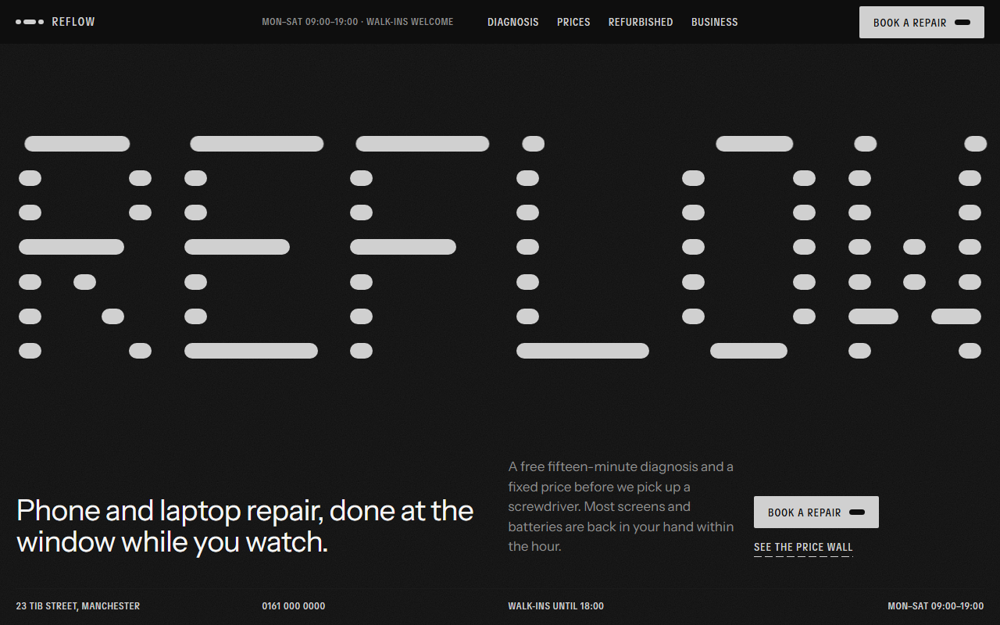

# Free HTML repair shop website template with GSAP scroll animations

Repair shop website template: one free HTML file for a phone, laptop or console repair business, with a twelve-row diagnosis checklist, a price wall, refurbished stock, office pickups, repair by post and a booking form. The look is near-black and white with one electric blue, and the wordmark is drawn from rounded dashes. It ships with an AGENTS.md, so an AI agent can rewrite it for your own shop.

[](LICENSE)  

**[Live demo](https://8bsite.github.io/repair-shop-website-template/)** · **[Use this template](https://github.com/new?template_name=repair-shop-website-template&template_owner=8bsite)** · **[Download ZIP](https://github.com/8bsite/repair-shop-website-template/archive/refs/heads/main.zip)** · **[Template page on 8b.com](https://8b.com/templates/reflow/)**

<a href="https://8bsite.github.io/repair-shop-website-template/"></a> <a href="https://8bsite.github.io/repair-shop-website-template/"></a>

<p align="center"><a href="https://8bsite.github.io/repair-shop-website-template/"></a><br><sub>Scroll animation</sub></p>

## Use it with Claude Code, Cursor or Codex

Download the four files into your project folder (`curl.exe` in Windows PowerShell):

```bash
curl -LO https://raw.githubusercontent.com/8bsite/repair-shop-website-template/main/index.html
curl -LO https://raw.githubusercontent.com/8bsite/repair-shop-website-template/main/AGENTS.md
curl -LO https://raw.githubusercontent.com/8bsite/repair-shop-website-template/main/LICENSE
curl -LO https://raw.githubusercontent.com/8bsite/repair-shop-website-template/main/CREDITS.md
```

Then fill in the angle brackets and give your agent this prompt:

```text
Read AGENTS.md, then edit index.html. Turn it into the website for <my repair business: shop name, town and address, what I repair, opening hours and latest walk in time, repair prices and bench times, part grades and warranty length, refurbished stock, business pickup route, repair by post terms, how customers book>. Replace first the shop name and its dash wordmark, then the price wall, address, hours and phone. Keep the section ids and the classes AGENTS.md lists, and keep each --m, --a and --b value in step with the time printed beside it. Ask me for missing facts and never invent prices, warranty terms, hours, addresses, reviews or contacts.
```

Begin with the shop name and the dash wordmark: the demo's six letters are rounded dashes in the markup, not a font. Then rewrite the price wall, address, hours and contacts. Vibe coding this in Claude Code, Cursor or Codex works when the agent asks the owner for prices, warranty terms, the pickup route, postage terms and who wrote each review. Keep the section ids and the classes AGENTS.md lists, and change the --m, --a and --b numbers that size the bars together with the printed times. As a computer repair shop website template it needs laptop checks in place of Face ID and camera flash; the list can change length, but the words twelve checks appear in four paragraphs.

No agent? Click **[Use this template](https://github.com/new?template_name=repair-shop-website-template&template_owner=8bsite)**, edit `index.html` on GitHub and turn on **Settings > Pages**.

## Sections and motion

- **Navigation**: top bar: dash mark and name, opening hours, section links, Book a repair button; phone menu overlay.
- **Reflow: Phone and laptop repair, done at the window while you watch.**: two screens: a dash-built wordmark with headline and contact bar, then a staircase statement with three photos (demo: REFLOW, "Most broken things are fixable."). Smooth scrolling throughout; small uppercase lines spread word by word to full width. On the held first screen the dash wordmark stretches and floods white, then staircase words slide in over rising photos.
- **Fifteen minutes, free, out loud.**: service explainer: staircase heading, paragraph and a twelve-row checklist with results and a quote (demo: the free diagnosis). Pinned on large screens, a blue band steps down the twelve checks as you scroll, turning each from Queued to its result.
- **Price wall**: price list table grouped by device, each row with models, a time bar and a price (demo: Price wall). As each device group appears, its time bars draw from the left, and a blue selection sweeps over the cheaper-price promise.
- **Fixed at the window.**: how-we-work block: staircase heading over a wide photo cut into four strips, three columns of text (demo: "Fixed at the window."). Tied to scroll, four strips of the workshop photo slide from staggered heights into one picture.
- **Three grades of part. You choose, and the receipt names the one we fitted.**: comparison table of three options with four rows and an example price (demo: Original, Certified, Value parts). As the comparison table comes into view, the dash beside each row label draws in from the left.
- **Second life**: horizontal shelf of numbered products with photo, specs, price and a Reserve link (demo: five refurbished devices). The section pins and the shelf of five refurbished devices runs sideways as you scroll.
- **For offices and schools: we collect on a weekly route, leave a loan device for every one we take and invoice once a month.**: business offer with a weekly schedule drawn as bars on an hour grid (demo: office and school pickups, Monday to Friday). Tied to scroll, a blue cursor sweeps the hour grid; pickup bars it passes turn dark, the ones under it blue.
- **Post it.**: how it works: four steps under one dashed line and a button (demo: repair by post). The four dashes above the steps draw in from the left, one after another, as the steps come into view.
- **Reviews**: three customer quotes in large type, each with name and device. Tied to scroll, a blue selection box jumps word by word along each quote, as if someone were reading it.
- **Before you ask.**: questions and answers (native &lt;details&gt;).
- **Come to the bench.**: contact and booking: staircase heading, address, hours, phone and email, a photo and a booking form (placeholders). Tied to scroll, the heading grows from one small line into a big three-line staircase.
- **Footer**: dashed rule, one-line description, address, contact and page links, copyright and the Design: 8B credit. The dashed rule that opens the footer draws in dash after dash as it appears.

## Design

 near-black grained sections  
 off-white sections, headings  
 text on dark, wordmark  
 muted text on dark  
 muted text on light  
 electric blue highlights  
 hairlines on dark  
 hairlines, form panel

**Instrument Sans**: headings and body, very large and tight. **TikTok Sans**: condensed uppercase labels and buttons (Google Fonts). A four-column grid where near-black and off-white sections take turns. Headings step across the columns like a staircase. Rounded dashes are the motif: they build the wordmark and mark buttons, time bars, steps and the footer rule. Electric blue is kept for highlights, and most photos sit in barely rounded tiles.

## Questions

**Is this a cell phone repair website template or does it cover laptops too?**  
It covers both. The price wall has three groups: five phone repairs, five laptop repairs and three for tablets and consoles. The twelve diagnosis checks lean towards phones, with Face ID and Cameras and flash among them, so a laptop-only shop should rename a few. The demo prices are in pounds with VAT included, so change the currency and the tax wording too.

**How do I change the prices and bench times?**  
Edit the cells of the HTML table in the prices section. Each dash bar takes its length from a --m value in minutes, where 180 is the full three hour scale, so change --m together with the printed time. Rows can be added or removed freely. The note under the table about water damage and data recovery is plain text.

**Does the booking form send anything?**  
No, not yet. Pressing Book a slot only runs a check on the name and contact fields, then prints the thank-you or the error text next to the button; no request leaves the page. To receive bookings, connect Formspree or Netlify Forms, or delete the form with its script and keep the email link. Rewrite the promised confirmation within the hour as well.

## Is it the right base?

It fits where a visible price list and a bench customers can watch decide the sale, with rebuilt devices or office accounts as a sideline. A shop that quotes every job by hand may prefer the live calculator in the [print studio](https://8b.com/templates/dotdrum/) template, and a phone repair template for a post-only business would rewrite the window bench claims and keep the four posting steps. As a repair service template it has one clear limit: it is built for enquiries, not stock or payments. The form sends nothing yet, and every Reserve link jumps to the booking section.

## Before you publish

- Replace what is marked `data-8b-placeholder` (social preview image, favicon, phone, email, form) and the invented demo facts; [AGENTS.md](AGENTS.md) lists them.
- The form sends nothing yet: connect it to Formspree or Netlify Forms, or remove it.

## Tech

GSAP 3.13.0, ScrollTrigger, SplitText, Lenis 1.3.27 from jsDelivr, 108 KB, no build step. Chrome and Edge 108+, Safari 16+, Firefox 110+ (it uses container query units, cascade layers, small/dynamic viewport units). With "reduce motion" on, the page is complete and still.

## License

MIT, see [LICENSE](LICENSE). Photos, fonts and libraries keep their own licences: [CREDITS.md](CREDITS.md). More free templates: [8b.com/templates](https://8b.com/templates/) · [github.com/8bsite](https://github.com/8bsite).
