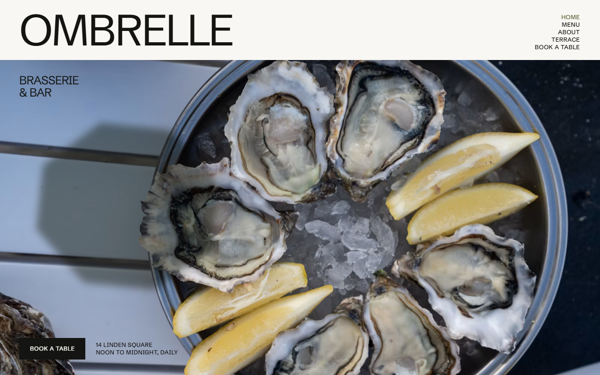
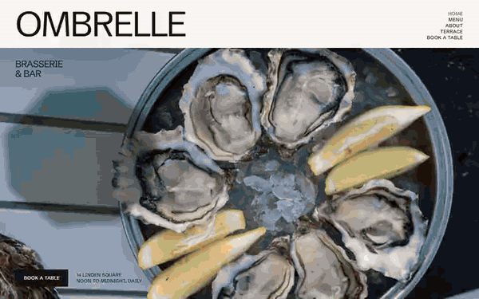

# Free HTML restaurant website template with GSAP scroll animations

Restaurant website template: a free one-page site for a brasserie, bistro or bar, with a menu in four courses, a bar card, five daily services, seating areas and a table booking form. The look is huge uppercase type on near-white, olive and night grounds. It is one HTML file with an AGENTS.md, so an AI agent can adapt it to your own restaurant.

[](LICENSE)  

**[Live demo](https://8bsite.github.io/restaurant-website-template/)** · **[Use this template](https://github.com/new?template_name=restaurant-website-template&template_owner=8bsite)** · **[Download ZIP](https://github.com/8bsite/restaurant-website-template/archive/refs/heads/main.zip)** · **[Template page on 8b.com](https://8b.com/templates/ombrelle/)**

<a href="https://8bsite.github.io/restaurant-website-template/"></a> <a href="https://8bsite.github.io/restaurant-website-template/"></a>

<p align="center"><a href="https://8bsite.github.io/restaurant-website-template/"></a><br><sub>Scroll animation</sub></p>

## Use it with Claude Code, Cursor or Codex

Download the four files into your project folder (`curl.exe` in Windows PowerShell):

```bash
curl -LO https://raw.githubusercontent.com/8bsite/restaurant-website-template/main/index.html
curl -LO https://raw.githubusercontent.com/8bsite/restaurant-website-template/main/AGENTS.md
curl -LO https://raw.githubusercontent.com/8bsite/restaurant-website-template/main/LICENSE
curl -LO https://raw.githubusercontent.com/8bsite/restaurant-website-template/main/CREDITS.md
```

Then fill in the angle brackets and give your agent this prompt:

```text
Read AGENTS.md, then edit index.html. Make it the site for <my restaurant: name, kind of food, address, opening hours, kitchen and bar hours, menu with dishes and prices, bar card, seats per area, booking rules, phone, email, Instagram>. Replace first the name, the address and hours, the four menu courses with their prices, and the bar card. Keep the section ids, the data attributes and the classes AGENTS.md lists, and set each --len number to its heading's character count. Drop the supplier notes and guest quotes unless I give you real ones. Ask me for any missing fact and never invent prices, hours, allergens, suppliers, reviews or contacts.
```

In a vibe coding session with Claude Code, Cursor or Codex, start with the facts only the owner has: name, address, opening hours, kitchen and bar hours, every dish and price, the allergen note, seat counts, booking rules and real contacts. The agent should ask for them, never invent them. Prices are data elements, so change the value and the visible number together, and name the currency in the note beside the menu heading. Keep the section ids, the data attributes and the classes AGENTS.md lists, and reset each --len number to its heading's new character count. Remove the deliveries and quotes sections unless real suppliers and guests can fill them.

No agent? Click **[Use this template](https://github.com/new?template_name=restaurant-website-template&template_owner=8bsite)**, edit `index.html` on GitHub and turn on **Settings > Pages**.

## Sections and motion

- **Navigation**: header: wordmark, five section links (Book a table last); compact bar on scroll up; phone menu overlay.
- **Ombrelle**: first screen: huge wordmark, full-bleed dish photo, Book a table; then the menus intro and a photo pair (demo: brasserie and bar). Smooth scrolling runs page-wide. A blurred parasol shadow sways over the hero dish; on scroll it slides across, warm light rises and the photo pair climbs at two speeds.
- **Lunch that runs into the evening**: olive full-width block: three-line justified heading and a short story. Tied to scroll, the olive field opens from a small circle to full screen as the heading lines slide in.
- **Ombrelle moments**: photo grid of six with a Follow us link (social feed). Photos open from a thin centre slit as they arrive; a parasol shadow drifts across two as you scroll.
- **Noon to midnight**: opening hours as a horizontal track of five services, ground going from day to night (demo: Lunch, Coffee hour, Aperitivo, Dinner, Last glass). Pinned: the five services slide sideways, the ground darkens from near-white through olive to night, photos shift in their frames.
- **The brasserie card**: the menu: courses with dishes, short descriptions and prices, sticky course index and one photo. The heading slides in with your scroll, the photo opens from a slit, and except on phones the course index stays put.
- **This morning**: five ingredients or suppliers with photos and where each goes on the menu (demo: the day's deliveries). The five ingredient photos start as a tilted pile and deal out into a row, or a grid on phones, as you scroll.
- **After five**: dark bar section: drinks and small plates with prices, two bar photos. On the night ground the heading slides in with your scroll and both bar photos open from a slit.
- **Under the parasols**: seating areas with seat counts beside a drawn plan of the house, wide photo of the square. Tied to scroll, the twelve parasols spin open row by row, then the room, counter and back room draw in.
- **Said at the table**: three guest quotes set large, alternating sides. Each quote drifts in from its side and out the other as it passes, the guest's name moving against it.
- **Book a table**: booking form and the restaurant's details (address, hours, phone, email). The Book a table heading slides in sideways, tied to scroll, beside the booking form.
- **Footer**: night footer: four link columns, width-filling wordmark, copyright and the Design: 8B credit. The wordmark's letters start spread apart and close into the full-width name as the footer arrives.

## Design

 page background  
 text, buttons, rules  
 olive: story field, aperitivo panel, phone menu  
 night: bar, footer, the day track's end  
 dark olive parasol stripes  
 warm grey descriptions and captions  
 parasol shadow over photos  
 amber light warming the hero photo

**Schibsted Grotesk**: the only typeface: regular-weight uppercase headings, tight; small tracked labels (Google Fonts). Uppercase headings are scaled to set widths, and the footer wordmark runs edge to edge. Corners are square, photos sit 8 pixels apart, menus run on thin rules with prices flush right, and a drawn plan shows the house with striped round parasols.

## Questions

**Can I use it for a cafe website that closes before dinner?**  
Yes. Cafe websites usually keep shorter hours, and the five services in the day section are plain HTML, so rename them and change their times. The noon to midnight hours also sit in the opening, the phone menu, the contact details, the footer, the page title and the meta description; AGENTS.md lists every place.

**Does the booking form take reservations?**  
No, not yet. The form asks for name, phone or email, date, time, guests, area and a note, checks the name, contact and date, then shows a thank-you line and sends nothing. Connect Formspree or Netlify Forms, or point the Book a table buttons at OpenTable, Resy, TheFork or SevenRooms. Edit the promise to confirm within the hour.

**How do I change the menu and the prices?**  
Edit the text in the four courses, each with three dishes, and in the two bar card groups. Every price is a data element, so update its value attribute and its visible number. If you rename or add a course, change its id and its link in the course index. To publish a PDF menu instead, point Explore the menus and the Menu links at the file.

## Is it the right base?

As a website template for restaurant owners, it fits when the kitchen keeps a daily rhythm and the room has areas worth showing: a terrace, a counter, a private room. A taproom that brews its own beer is closer to the [brewery](https://8b.com/templates/loud-kettle/) template. It has no ordering or payment, so a delivery business needs a different base. The weak spot is the menu's position: it is the fifth section, reached after a pinned sideways track when motion is on, so keep the Menu link in the header.

## Before you publish

- Replace what is marked `data-8b-placeholder` (social preview image, favicon, social, phone, email, form) and the invented demo facts; [AGENTS.md](AGENTS.md) lists them.
- The form sends nothing yet: connect it to Formspree or Netlify Forms, or remove it.

## Tech

GSAP 3.13.0, ScrollTrigger, SplitText, Lenis 1.3.11 from jsDelivr, 83 KB, no build step. Chrome and Edge 111+, Safari 16.2+, Firefox 113+ (it uses color-mix(), cascade layers, small/dynamic viewport units). With "reduce motion" on, the page is complete and still.

## License

MIT, see [LICENSE](LICENSE). Photos, fonts and libraries keep their own licences: [CREDITS.md](CREDITS.md). More free templates: [8b.com/templates](https://8b.com/templates/) · [github.com/8bsite](https://github.com/8bsite).
