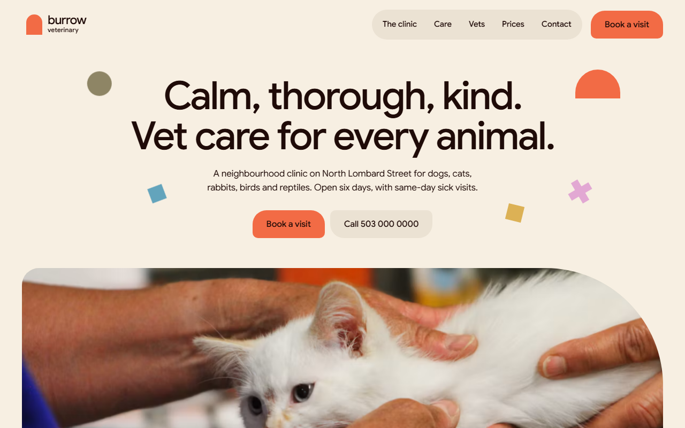
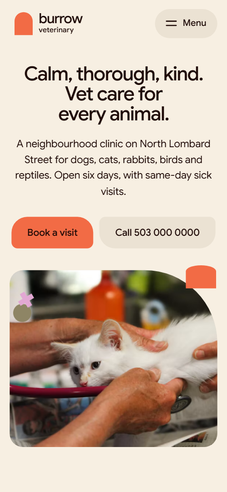

# Free HTML veterinary website template with GSAP scroll animations

Veterinary website template: a free one-page site for a vet clinic or animal hospital, with a four-step visit guide, services, vets, recent patients, a price list and a visit request form. The look is cream with coral arches and flat colour shapes. It is one HTML file with an AGENTS.md, so Claude Code, Cursor or Codex can adapt it to your practice.

[](LICENSE)  

**[Live demo](https://8bsite.github.io/veterinary-website-template/)** · **[Use this template](https://github.com/new?template_name=veterinary-website-template&template_owner=8bsite)** · **[Download ZIP](https://github.com/8bsite/veterinary-website-template/archive/refs/heads/main.zip)** · **[Template page on 8b.com](https://8b.com/templates/burrow/)**

<a href="https://8bsite.github.io/veterinary-website-template/"></a> <a href="https://8bsite.github.io/veterinary-website-template/"></a>

<p align="center"><a href="https://8bsite.github.io/veterinary-website-template/"></a><br><sub>Scroll animation</sub></p>

## Use it with Claude Code, Cursor or Codex

Download the four files into your project folder (`curl.exe` in Windows PowerShell):

```bash
curl -LO https://raw.githubusercontent.com/8bsite/veterinary-website-template/main/index.html
curl -LO https://raw.githubusercontent.com/8bsite/veterinary-website-template/main/AGENTS.md
curl -LO https://raw.githubusercontent.com/8bsite/veterinary-website-template/main/LICENSE
curl -LO https://raw.githubusercontent.com/8bsite/veterinary-website-template/main/CREDITS.md
```

Then fill in the angle brackets and give your agent this prompt:

```text
Read AGENTS.md, then edit index.html. Turn it into the site for <my practice: clinic name, town and address, the animals we see, vets and nurses with roles, services with prices, opening hours, night and Sunday emergency cover, insurance and payment terms, how clients book>. Replace first the clinic name, address, vets and price rows. Keep the section ids, the classes AGENTS.md lists and the opening in one section, and use no more than four small shapes besides its arch. Ask me for every missing fact. Never invent prices, hours, addresses, licences, reviews, vet names or contacts.
```

For vibe coding with Claude Code, Cursor or Codex, tell the agent to begin with facts only the clinic has: name, town and address, each vet and role, the price of every service, hours, night and Sunday cover, insurance and payment terms. It should ask for each one and never make up a price, a licence or a review. The demo contradicts itself on staff, with four vets in the species text and three in the team intro, so make them agree. Leave the section ids and the classes AGENTS.md lists alone. The opening animation has a fling path for four small shapes other than the arch, so do not add a fifth.

No agent? Click **[Use this template](https://github.com/new?template_name=veterinary-website-template&template_owner=8bsite)**, edit `index.html` on GitHub and turn on **Settings > Pages**.

## Sections and motion

- **Navigation**: top bar: arch logo and wordmark, section links, Book a visit button; phone menu overlay.
- **Calm, thorough, kind. Vet care for every animal.**: first screen: headline, two buttons, wide photo and floating shapes; second screen: four numbered steps of a visit on a coral arch. Smooth scrolling throughout; several section headings rise line by line. On scroll, the small coral arch near the headline grows into the doorway behind the visit steps as the other shapes fly outward.
- **Two doors. Cats never wait with dogs.**: two arch-cut photos either side of the copy (demo: separate cat and dog sides of the clinic). Tied to scroll, the cat and dog photos slide out from the centre to either side as their narrow arch masks widen.
- **Small, scaly, feathered or furry.**: four overlapping colour panels, one per group (demo: animals the clinic treats). The four colour panels start stacked and tilted in the middle and are dealt out into an overlapping row as you scroll; small shapes drift past.
- **What we do here.**: list of six services, each row with a photo, text and a short note. Tied to scroll, each row's photo opens from a small pill to a full frame and its rule grows in the row's colour.
- **Who you’ll meet in the room.**: four people with portraits, role and one line (demo: vets and head nurse). As the team scrolls into view, each portrait opens from a circle, arch, square or diamond into its full frame.
- **This month at Burrow.**: pinned horizontal row of seven cards (demo: patients of the month, name, breed, age, why they came). The section pins while seven patient cards slide sideways; cards away from the centre drop and tilt, so the row curves like a wheel.
- **Prices you see before we start.**: dark band: price list (service, what is included, price) and a note on estimates.
- **On Lombard Street since 2014.**: sticky building photo beside three dated paragraphs (demo: the clinic's history). The sticky building photo starts close on the ground floor, pans to the top floor and pulls back to the whole corner as you read.
- **Before you come in.**: questions and answers (native &lt;details&gt;).
- **Come in.**: coral arch panel: address, phone, email, hours, photo and a visit request form. As the section scrolls in, the coral panel grows and rises while its top corners round into a tall arch.
- **Footer**: rounded panel: brand line, address, three link columns, copyright and the Design: 8B credit.

## Design

 cream page background  
 dark brown text and prices band  
 darker cream panels and cards  
 grey-brown secondary text such as roles, captions and footer lines  
 coral buttons, arches and contact panel  
 blue dogs panel and shapes  
 mustard round cats panel  
 rust small mammals panel  
 green birds and reptiles panel  
 pink accent shapes  
 khaki circle accents beside the first headline and the species panels

**Google Sans**: all text: large medium-weight headings with tight letter spacing, regular body copy (Google Fonts). A cream page with centred headings in several sections and flat shapes (arch, circle, square, quarter-circle, diamond, plus) used as bullets and step markers. Photos sit in cut frames: arch-topped doors, circles, one huge rounded corner. Coral arches frame the visit steps and the contact panel, and most buttons have rounded tops.

## Questions

**Where do visit requests go when someone submits the form?**  
Nowhere, as shipped. The form asks for a name and phone, both required, plus the animal's name, a species and what is going on. The script checks the required fields, shows a thank-you line and clears the form, but nothing leaves the page. Connect Formspree or Netlify Forms, using the steps in AGENTS.md, or remove the form and keep the email link.

**What do great vet websites have in common?**  
Clear services, visible prices, named vets, the species treated, opening hours and an easy way to ask for a visit. This template has a section for services, prices, vets and species, puts the hours beside the request form, and adds the clinic's story and a six-question FAQ.

**Can I use it for an exotic-pet practice, or a clinic that sees only cats and dogs?**  
Yes, both. The species section has four colour panels, and the form's species menu has five options: rewrite them to match the animals you treat. The section on separate cat and dog sides describes two entrances in the demo, so if your building has one, rewrite its copy and photos or delete the section as AGENTS.md describes.

## Is it the right base?

This vet template is the right base when a clinic has a team, a list of services and published prices, and wants a warm, playful page instead of a clinical one. If most of your business is overnight stays, the [cat boarding](https://8b.com/templates/sill/) template starts from rooms and nightly prices, which this page does not have. The weak spot is booking: there is no appointment calendar or online payment, only a request form that sends nothing until you connect a service, and the Book a visit buttons just scroll to it.

## Before you publish

- Replace what is marked `data-8b-placeholder` (social preview image, favicon, phone, email, map, form, social) and the invented demo facts; [AGENTS.md](AGENTS.md) lists them.
- The form sends nothing yet: connect it to Formspree or Netlify Forms, or remove it.

## Tech

GSAP 3.13.0, ScrollTrigger, SplitText, Lenis 1.3.27 from jsDelivr, 104 KB, no build step. Chrome and Edge 108+, Safari 15.4+, Firefox 101+ (it uses cascade layers, small/dynamic viewport units). With "reduce motion" on, the page is complete and still.

## License

MIT, see [LICENSE](LICENSE). Photos, fonts and libraries keep their own licences: [CREDITS.md](CREDITS.md). More free templates: [8b.com/templates](https://8b.com/templates/) · [github.com/8bsite](https://github.com/8bsite).
